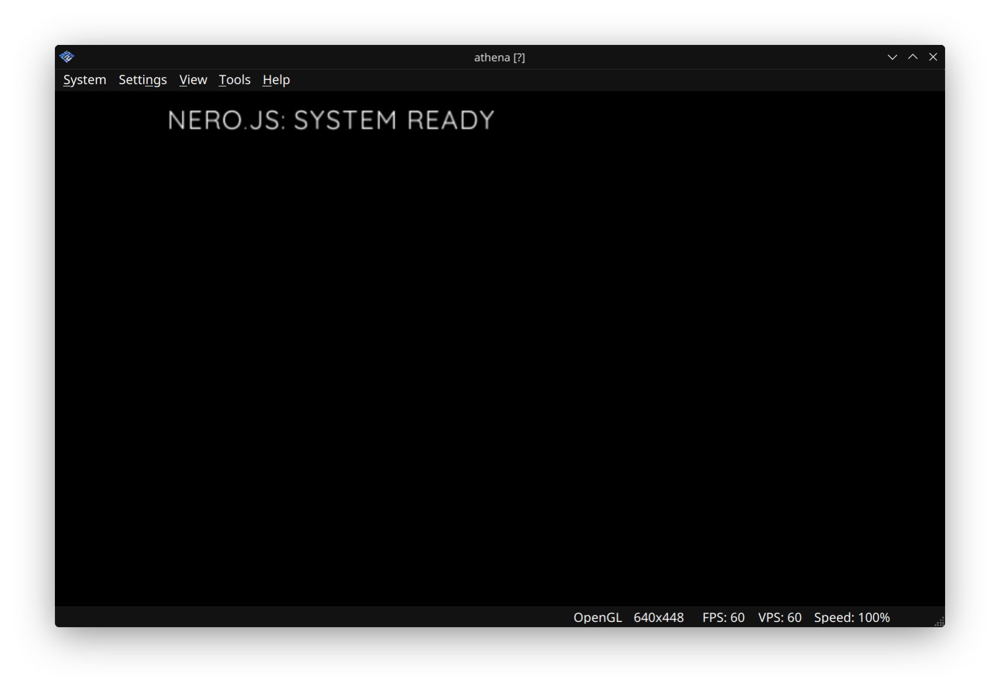
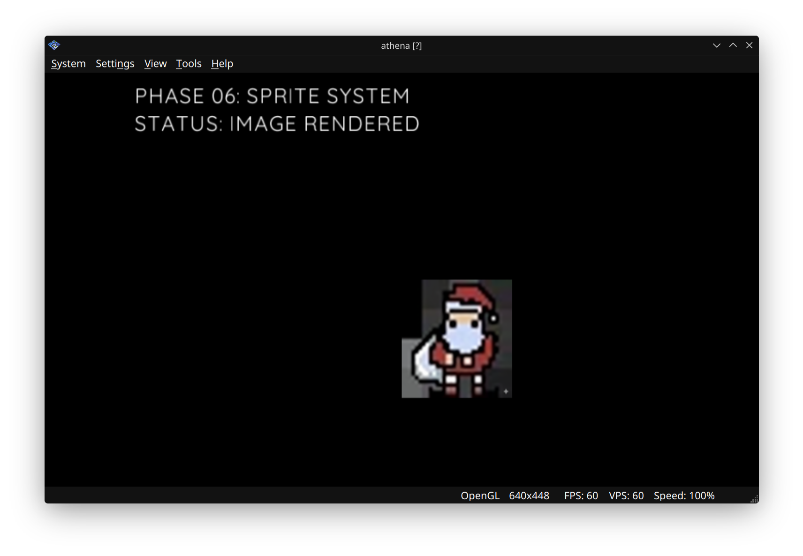
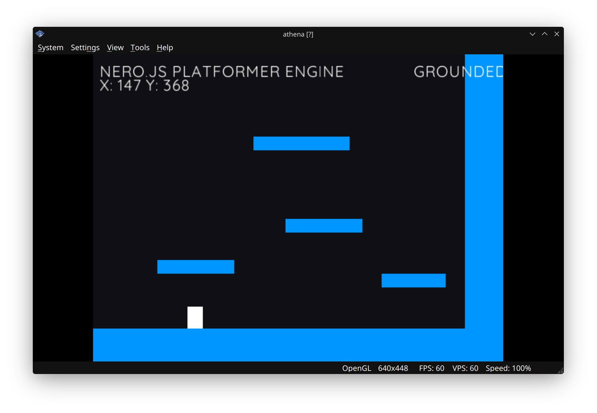
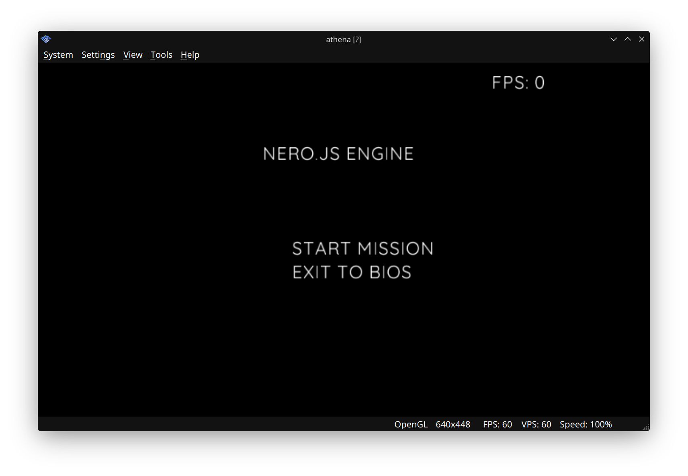
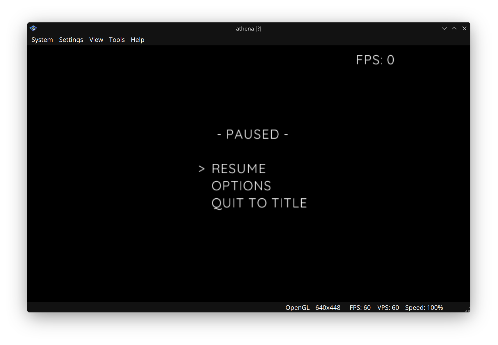

# PS2-Programming

**JavaScript examples and technical modules for PlayStation 2 homebrew.**

Nine samples live in [`ps2_examples/`](ps2_examples). Each folder already contains the same prebuilt [AthenaEnv](https://github.com/DanielSant0s/AthenaEnv) loader (`athena.elf`), an `athena.ini` that starts `main.js`, and a short README. Boot a folder in PCSX2 and read the script beside it. These are educational samples.

If a sample boots in PCSX2, a star helps the next person find it.

## On screen

PCSX2 window captures checked into the repo. Open a tile for that sample.

<table>
  <tr>
    <td align="center" width="33%">
       
      <a href="ps2_examples/01_Hello_World_BaseLine"><b>01 Hello World</b></a> 
      default font · one loop
    </td>
    <td align="center" width="33%">
       
      <a href="ps2_examples/06_Sprite"><b>06 Sprite</b></a> 
      PNG in VRAM · D-pad move
    </td>
    <td align="center" width="33%">
       
      <a href="ps2_examples/08_Physics_Collisions"><b>08 Physics</b></a> 
      gravity · jump · AABB
    </td>
  </tr>
  <tr>
    <td align="center">
       
      <a href="ps2_examples/07_Save_System"><b>07 Save</b></a> 
      JSON · memory card or host file
    </td>
    <td align="center">
       
      <a href="ps2_examples/09_Scene_Management"><b>09 Title</b></a> 
      scene state machine
    </td>
    <td align="center">
       
      <a href="ps2_examples/09_Scene_Management"><b>09 Pause</b></a> 
      overlay on the game scene
    </td>
  </tr>
</table>

Samples 02–05 keep PCSX2 captures beside their scripts. Those four files are WebP data with a `.png` name, and GitHub serves that name as `image/png`, so the gallery above uses the real PNG captures. The [game scene](ps2_examples/09_Scene_Management/09_game_view.png) capture sits with the title and pause shots.

## Run

No compile step. The loader is already in each sample folder.

1. Use [PCSX2](https://pcsx2.net/) 1.7 or newer, with a BIOS you already have.
2. Under **Settings → Emulation**, enable **Enable host filesystem**. AthenaEnv reads `main.js` and assets through that host path.
3. **System → Start File…** and open one ELF, for example [`ps2_examples/01_Hello_World_BaseLine/athena.elf`](ps2_examples/01_Hello_World_BaseLine/athena.elf).
4. `athena.ini` in that folder sets `default_script = "main.js"`, `boot_logo = true`, and `audsrv = true`. Edit `main.js`, then reset the emulator to reload it.

Start with [01 Hello World](ps2_examples/01_Hello_World_BaseLine). Each later folder's README lists the controls and the calls that sample makes.

## Samples

| | Module | What the script does |
| :--- | :--- | :--- |
| 01 | [Hello World](ps2_examples/01_Hello_World_BaseLine) | Clears the screen and prints `NERO.JS: SYSTEM READY`. |
| 02 | [Input Debug](ps2_examples/02_Input_Debug) | Prints DualShock 2 buttons and sticks. L1 and R1 call `Pads.rumble()`. |
| 03 | [UI Components](ps2_examples/03_UI_Components) | Four-item menu (`START GAME`, `LOAD DATA`, `OPTIONS`, `EXIT`) with input debounce. |
| 04 | [Audio](ps2_examples/04_Audio) | Streams `host:assets/music.wav` with `Sound.Stream`. That WAV is not in the repo. Add your own 16-bit PCM file at `ps2_examples/04_Audio/assets/music.wav` before expecting playback. |
| 05 | [XMB Wave](ps2_examples/05_XMB_Wave) | Draws layered sine waves. R1 cycles five themes. Circle toggles ribbon and segmented drawing. |
| 06 | [Sprite](ps2_examples/06_Sprite) | Loads [`assets/icon.png`](ps2_examples/06_Sprite/assets/icon.png) and moves it with the D-pad after `myIcon.ready()`. |
| 07 | [Save System](ps2_examples/07_Save_System) | Writes a JSON counter to `mc0:/NERO.JSN`. If the memory card path fails, it falls back to `host:nero_save.json` beside the ELF. |
| 08 | [Physics](ps2_examples/08_Physics_Collisions) | Platformer loop: gravity, walk, jump, and rectangle overlap against a platform list. |
| 09 | [Scene Management](ps2_examples/09_Scene_Management) | Title, game, pause, and options scenes, plus a fade into the game scene. |

This repository contains samples 01 through 09. Sample 09's README points onward to a particle sample that has no folder here.

## Runtime

The scripts are JavaScript for [AthenaEnv](https://github.com/DanielSant0s/AthenaEnv) by Daniel Santos, a QuickJS-based loader for PlayStation 2 homebrew. Entry points and host paths are described in the [AthenaEnv intro](https://athena-env.vercel.app/docs/intro). The docs site source is [Daniel Abrante's athena-env-website](https://github.com/DanielAbrante/athena-env-website).

Every `athena.elf` in this repo is the same prebuilt loader. Building AthenaEnv from source is documented in the upstream repository.

## Author

[Robert Fernandez](https://robertfernandez.dev) — Cross-Platform Software Engineer & Digital Artist. Design-first software across web, desktop, mobile, Wear OS, embedded displays, and retro consoles.

[robertfernandez.dev](https://robertfernandez.dev) · [GitHub @robfernan](https://github.com/robfernan)

MIT License. See [LICENSE](LICENSE).
