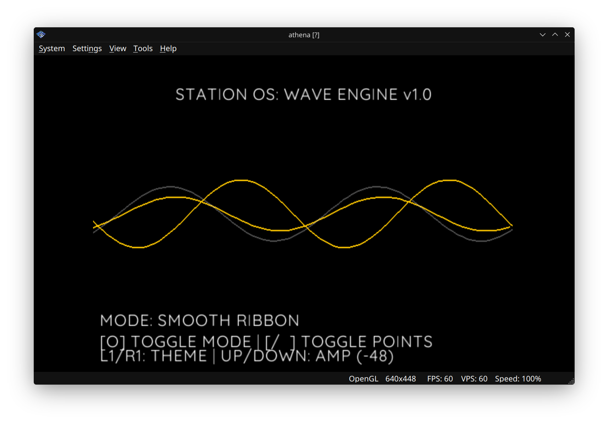
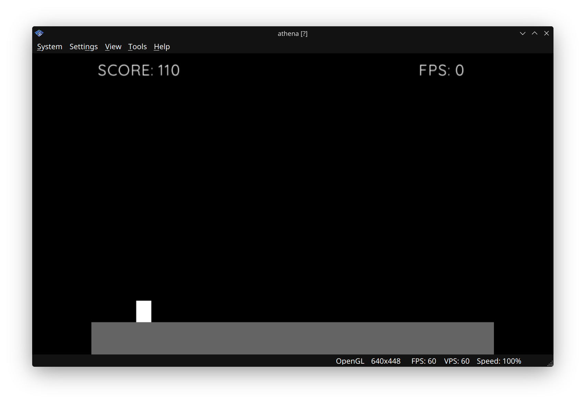

# 🕹️ PS2-Programming
**"Engineering Modern Systems on Legacy Hardware"**

[](https://developer.mozilla.org/en-US/docs/Web/JavaScript)
[](https://www.playstation.com/)

This repository contains a comprehensive collection of technical modules and examples for **PlayStation 2** development using **AthenaEnvJS**. My work focuses on expanding and documenting the capacity of this environment to bridge modern JavaScript logic with legacy GS/VU1 hardware.

---

## ⚡ Why JavaScript on PS2?
AthenaEnvJS isn't just a wrapper; it's a high-performance environment that makes retro development accessible:
* **FPU Optimized:** Uses specialized `float32` semantics tailored for the PS2's 32-bit hardware.
* **Native Performance:** Leverages an Ahead-Of-Time (AOT) compiler to translate complex math functions directly into **MIPS R5900** machine code.
* **Modern Workflow:** Use ES6+ syntax to manage VRAM, sprites, and SPU2 audio processes without the traditional overhead of legacy C toolchains.

---

## 🔗 Official Framework & Ecosystem
For those interested in the underlying framework or official documentation, please visit:
* **Core Framework:** [AthenaEnv by Daniel Santos](https://github.com/DanielSant0s/AthenaEnv) — The QuickJS-based runtime for the PS2.
* **Documentation Hub:** [AthenaEnv Website by Daniel Abrante](https://github.com/DanielAbrante/athena-env-website) — The Docusaurus-based center for framework content and standards.

---

## 🧱 Module Overview (Completed ✅)
These nine modules represent a verified foundation of systems engineering on real PS2 hardware.

| Module | Goal & Focus | Preview |
| :--- | :--- | :--- |
| **01: Hello World** | Display "Nero.JS: System Ready" with custom colors and fonts. | — |
| **02: Input Debug** | Full DualShock 2 controller mapping with real-time display. | — |
| **03: UI Components** | Functional menu system with selection logic and input debouncing. | — |
| **04: Audio Engine** | Stream 16-bit PCM WAV audio using the PS2 SPU2 processor. | — |
| **05: XMB Wave** | Animated procedural background inspired by the PlayStation XMB. |  |
| **06: Sprite System** | Load PNG images into VRAM and render 2D sprites. | — |
| **07: Save System** | JSON-based data saving to physical/virtual Memory Cards. | — |
| **08: Physics** | Platformer engine with gravity and pixel-perfect collision. |  |
| **09: Scene Mgmt** | State machine for Title, Game, and Pause transitions. | See Below |

### **Scene Management Preview**

<p align="center">
  
   
  
</p>

---

## 🚀 Getting Started
1. **Emulator:** Use [PCSX2](https://pcsx2.net/) (v1.7+ recommended). 
2. **Setup:** Under `Settings > Emulation`, ensure **"Enable host filesystem"** is checked.
3. **Run:** Boot the `athena.elf` file and point it toward the script directory of the module you wish to test.

---

## 🔮 Future Vision: The Universal Workflow
My long-term goal is to merge these low-level retro modules into a unified, cross-platform pipeline. The objective is a single codebase that can be deployed across modern and legacy systems simultaneously.

### **Target Ecosystem**
* **Modern:** Web (HTML/CSS/JS), Desktop (NW.js), and Mobile (Capacitor).
* **Legacy:** PlayStation 2 (Active), PS1, PSP, PS3, Dreamcast, and Game Boy.

### **Universal Boilerplate Concept**

```javascript
while (true) {
    // This loop is translated by the Framework into:
    // PS2: Screen.flip() | Web: requestAnimationFrame() | Mobile: Canvas Draw
    Screen.clear(black);
    font.print(10, 10, "SYSTEM READY: CROSS-PLATFORM", white);
    Screen.flip();
}

```

---

**Happy Hacking!**
*Created by [Robert Fernandez*](https://github.com/robfernan)
