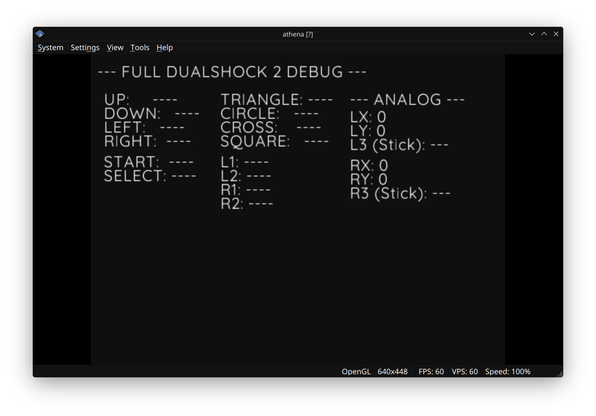

# 02: Input Debug

**Goal:** Full DualShock 2 controller mapping and debugging with real-time input display.



## Key Concepts Learned:

1. **Pad Object:** Using `Pads.get(0)` to access the first controller
2. **Button Mapping:** Checking button states with bitwise operations (`pad.btns & Pads.BUTTON`)
3. **Analog Sticks:** Reading left stick (LX, LY) and right stick (RX, RY) values
4. **Stick Buttons:** L3 and R3 (pressing the sticks)
5. **Rumble Feedback:** Triggering large and small motors with `Pads.rumble()`
6. **Color Coding:** Visual feedback (green for pressed, white for unpressed)

## What This Example Does:

- Displays all DualShock 2 inputs in real-time
- **Column 1:** D-Pad and System buttons (START, SELECT)
- **Column 2:** Face buttons (Triangle, Circle, Cross, Square) and Shoulder buttons (L1, L2, R1, R2)
- **Column 3:** Analog stick values and stick button presses
- **Rumble Test:** L1 triggers large motor, R1 triggers small motor

## Hardware Used:

- DualShock 2 Controller (all inputs)
- Rumble motors (Large and Small)

## Code Breakdown:

```javascript
const pad = Pads.get(0);  // Get first controller

while (true) {
    pad.update();         // Update controller state
    
    // Check button press
    let pressed = pad.btns & Pads.UP;
    
    // Read analog values
    let leftX = pad.lx;
    let leftY = pad.ly;
    
    // Trigger rumble
    Pads.rumble(0, largeMotor, smallMotor);
    
    Screen.flip();
}
```

## Next Steps:

Move to **03_UI_Components** to learn how to build interactive menus using this input system.
