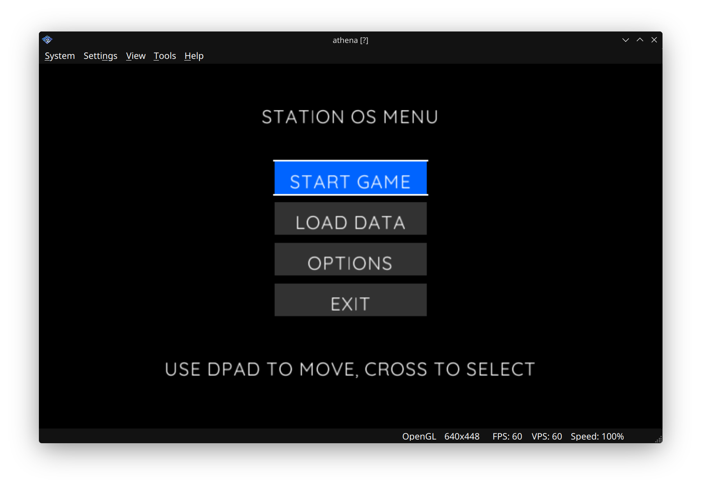

# 03: UI Components & Selection Logic

**Goal:** Build a functional menu system with selection highlighting and input debouncing.



## Key Concepts Learned:

1. **Selection Index:** Using a variable (`selected`) to track which menu item is active
2. **Input Debouncing:** Preventing rapid button presses from skipping multiple items with `inputTimer`
3. **Conditional Rendering:** Drawing buttons differently based on selection state (color/outline)
4. **Text Centering:** Using `font.getTextSize()` to calculate proper text positioning
5. **Button Drawing:** Creating custom UI elements with background boxes and outlines
6. **Action Mapping:** Triggering rumble feedback when CROSS is pressed

## What This Example Does:

- Displays a centered menu with 4 items: "START GAME", "LOAD DATA", "OPTIONS", "EXIT"
- Highlights the selected item with a blue background and white outline
- D-Pad Up/Down navigates the menu with debouncing to prevent skipping
- CROSS button triggers rumble feedback
- Title and hint text are centered on screen
- All UI elements use proper color coding (blue theme, white text, gray inactive buttons)

## Hardware Used:

- DualShock 2 Controller (D-Pad and CROSS button)
- Rumble motor feedback

## Code Breakdown:

```javascript
// Menu state
const menuItems = ["START GAME", "LOAD DATA", "OPTIONS", "EXIT"];
let selected = 0;

// Input debouncing
let inputTimer = 0;
const INPUT_DELAY = 10;

// Navigation with debouncing
if (inputTimer === 0) {
    if (pad.btns & Pads.UP) {
        selected--;
        if (selected < 0) selected = menuItems.length - 1;
        inputTimer = INPUT_DELAY;
    }
}

// Text centering
const textWidth = font.getTextSize(text).width;
const textX = x + (width / 2) - (textWidth / 2);

// Draw button with selection highlight
function drawButton(text, x, y, isSelected) {
    const bgColor = isSelected ? THEME_BLUE : GRAY;
    Draw.rect(x, y, width, height, bgColor);
    if (isSelected) {
        Draw.rect(x - 2, y - 2, width + 4, 2, WHITE); // Outline
    }
    font.print(textX, textY, text, WHITE);
}
```

## Next Steps:

Move to **04_Audio** to learn SPU2 audio streaming and sound playback.
