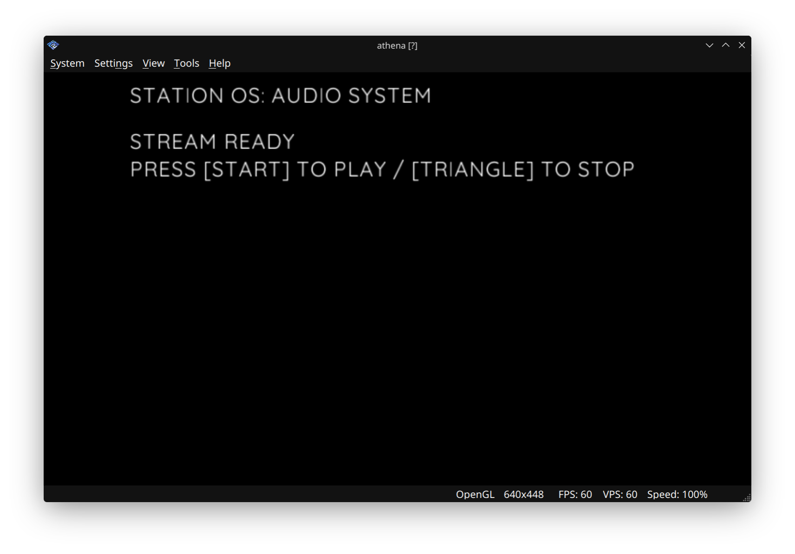

# 04: Audio Engine

**Goal:** Stream and playback 16-bit PCM WAV audio files using the PS2 SPU2 audio processor.



## Key Concepts Learned:

1. **Audio Streaming:** Using `Sound.Stream()` to load WAV files from the host filesystem
2. **State Management:** Handling loading, loaded, and error states for audio operations
3. **Playback Control:** Playing and stopping audio with `.play()` and `.stop()` methods
4. **Volume Control:** Adjusting audio levels with `Sound.setVolume()`
5. **Error Handling:** Detecting and reporting audio loading failures
6. **File Paths:** Understanding relative paths (`host:assets/music.wav`) for asset loading

## What This Example Does:

- Displays an audio system interface with state feedback
- Loads a 16-bit PCM WAV file from `assets/music.wav`
- Shows loading progress and error messages
- Allows playback control with START button
- Allows stopping with TRIANGLE button
- Sets volume to maximum with R1 button
- Provides troubleshooting hints if loading fails

## Hardware Used:

- PS2 SPU2 (Sound Processing Unit 2)
- DualShock 2 Controller (START, TRIANGLE, R1 buttons)

## Audio Requirements:

- **Format:** 16-bit PCM WAV
- **Location:** `04_Audio/assets/music.wav`
- **Size:** Up to 70MB+ supported
- **Path Format:** `host:assets/music.wav` (relative to ELF)

## Code Breakdown:

```javascript
// Load audio stream
bgm = Sound.Stream("host:assets/music.wav");

// Playback control
if (pad.btns & Pads.START) {
    bgm.play();
}

if (pad.btns & Pads.TRIANGLE) {
    bgm.stop();
}

// Volume control
if (pad.btns & Pads.R1) {
    Sound.setVolume(100);
}
```

## State Flow:

1. **READY TO LOAD** → Press CROSS to start loading
2. **LOADING** → Attempts to stream the WAV file
3. **ERROR** (if file not found) → Shows troubleshooting hints, press TRIANGLE to retry
4. **STREAM READY** → Press START to play, TRIANGLE to stop

## Troubleshooting:

- Ensure `music.wav` is 16-bit PCM format
- Check file path: `04_Audio/assets/music.wav`
- Verify file exists in the correct directory
- Large files (70MB+) may take time to load

## Next Steps:

Move to **05_XMB_Wave** to learn procedural animation and wave rendering.
