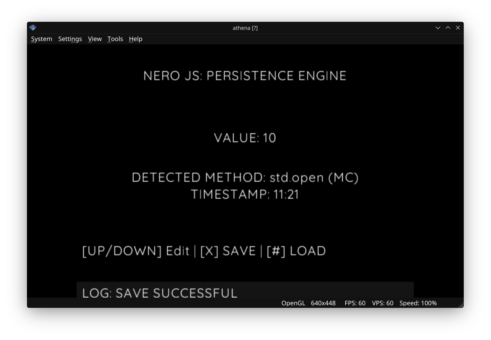

# 07: Save System & Persistence

**Goal:** Implement JSON-based data saving to physical/virtual Memory Cards with universal file I/O.



## Key Concepts Learned:

1. **JSON Serialization:** Using `JSON.stringify()` to convert objects to text and `JSON.parse()` to restore them
2. **Memory Card Access:** Using `mc0:/` (Slot 1) and `mc1:/` (Slot 2) device prefixes for file paths
3. **QuickJS Standard Library:** Using `std.open()`, `std.loadFile()` for robust file I/O in AthenaEnv
4. **Fallback Methods:** Supporting multiple save APIs (std, System, IO) for compatibility
5. **File Naming:** Using 8.3 character naming convention (NERO.JSN) for PS2 filesystem compatibility
6. **Boot-Time Auto-Loading:** Restoring user state automatically on startup

## What This Example Does:

- Stores application data (counter, timestamp, save method) to Memory Card
- Detects which save API is available and uses it automatically
- Displays the detected save method for debugging
- Allows incrementing/decrementing a counter value
- Saves data with timestamp to Memory Card Slot 1
- Loads previously saved data from Memory Card
- Shows success/error messages with color coding (green/red)
- Falls back to host filesystem if Memory Card fails

## Hardware Used:

- PS2 Memory Card (Slot 1: `mc0:/`)
- DualShock 2 Controller (D-Pad, Cross, Square buttons)

## Controls:

- **UP/DOWN:** Increment/Decrement the counter value
- **CROSS (X):** Save current data to Memory Card
- **SQUARE ([]):** Load data from Memory Card
- **Status Display:** Shows save method, timestamp, and operation results

## File Paths:

- **Memory Card:** `mc0:/NERO.JSN` (Slot 1, 8.3 naming convention)
- **Host Fallback:** `host:nero_save.json` (PC filesystem)

## Code Breakdown:

```javascript
// Save data as JSON
const success = NeroSaver.save(JSON.stringify(appData));

// Load data from Memory Card
const data = NeroSaver.load();
if (data) {
    appData = JSON.parse(data);
}

// Detect available save method
if (typeof std !== 'undefined' && std.open) {
    let f = std.open(MC_PATH, "w");
    f.puts(content);
    f.close();
}
```

## Save Methods (Priority Order):

1. **std.open()** - QuickJS Standard Library (Modern AthenaEnv)
2. **System.writeFile()** - Legacy PS2 System API
3. **System.saveFile()** - Alternative System API
4. **IO.writeFile()** - IO Module fallback

## ⚠️ IMPORTANT: Memory Card Formatting

**If you see "SAVE FAILED" on emulator:**

1. Boot the PS2 BIOS (press ESC in PCSX2 if running ELF directly)
2. Navigate to **Browser** → **Memory Card Utility**
3. Select **Slot 1** (mc0:/)
4. Choose **Format** and confirm
5. Return to the game and try saving again

**Note:** Virtual Memory Cards in PCSX2 must be formatted before first use, just like physical cards.

## Data Structure:

```javascript
{
    counter: 0,           // User-editable value
    lastSaved: "14:30",   // Timestamp of last save
    method: "std.open"    // Detected save method
}
```

## Troubleshooting:

- **"SAVE FAILED"** → Format Memory Card in BIOS
- **"NO SAVE FOUND"** → No previous save exists, create one first
- **"ERROR: No save function"** → ELF doesn't support any save API
- **Method shows "WAITING..."** → System still initializing

## Universal Portability:

This persistence engine is designed to be 100% portable to:
- **Web:** Replace `mc0:/` with `localStorage`
- **Desktop (NW.js):** Replace with Node.js `fs` module
- **Mobile (Capacitor):** Replace with device storage APIs

## Next Steps:

Move to **08_3D_Rendering** to learn hardware-accelerated 3D rendering with OBJ models.
